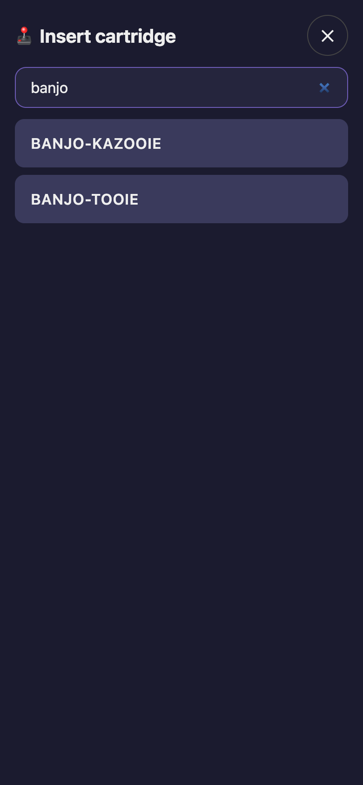
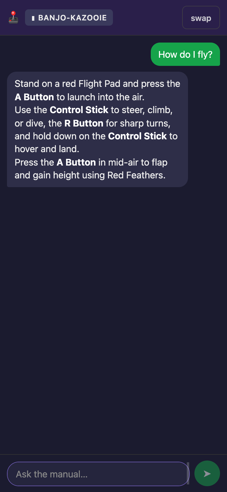
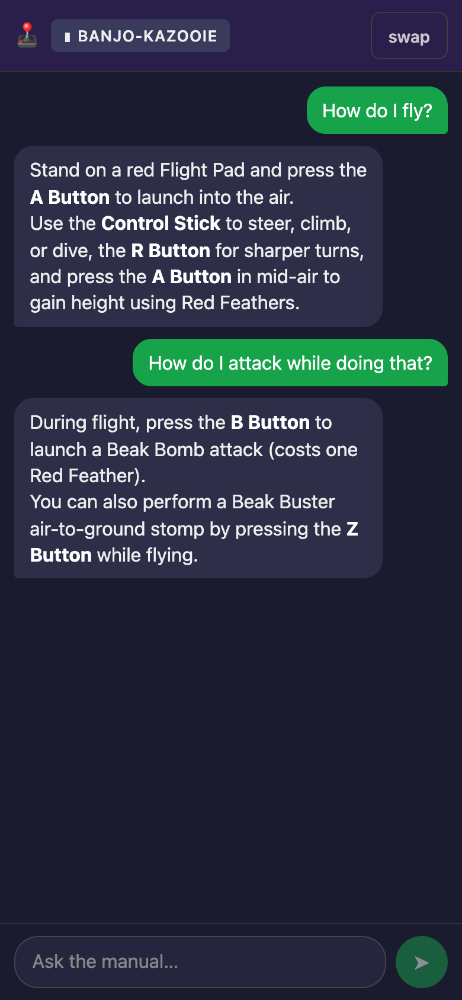
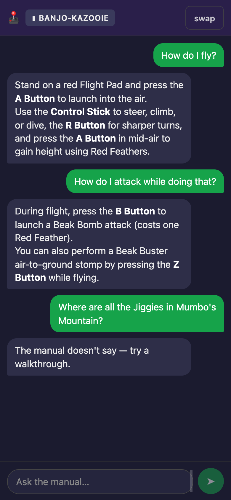

# Retro Gaming Chatbot

Ask questions about retro game manuals from your phone. Answers come only from the selected game's manual.

Currently supports Nintendo 64 manuals; other consoles can be added later.

## Screenshots

| Pick a game | Ask a question | Follow up | Not in the manual |
|---|---|---|---|
|  |  |  |  |

## Setup

1. Create your `.env`: `cp .env.example .env`, then set `GEMINI_API_KEY=your-key-here`.
   Optional settings: `N64_GEMINI_TIMEOUT` (seconds per Gemini call, default 120) and
   `N64_THINKING_BUDGET` (Gemini Flash thinking tokens, default 0 = off).
2. Install dependencies: `uv sync`

## Trial ingest

Try a couple of manuals first:

```
uv run n64-ingest --limit 2
uv run n64-ingest --game banjo
```

## Full ingest

```
uv run n64-ingest
```

It prints a cost estimate before transcribing. A full ingest downloads all the PDFs first (several GB of disk). Ingest is resumable (finished pages are kept on disk); re-run it to retry failures. Failures and OCR-fallback pages are listed in `data/ingest_failures.json`.

- Pages that fell back to OCR are retried with Gemini on every re-run.
- To re-transcribe one game, delete `data/pages/<slug>/` and run `uv run n64-ingest --game <slug>`.
- A `--game` run overwrites `ingest_failures.json`.
- Don't run ingest while the server is running; restart `n64-serve` after an ingest.

## Run the app

```
uv run n64-serve
```

Then open the printed `http://<LAN-IP>:8000` on your phone while on home Wi-Fi.

On macOS, you may be prompted to allow incoming connections for Python. Allow it, or your phone can't connect.

The app has no login and is meant only for your home network. Never port-forward it.
